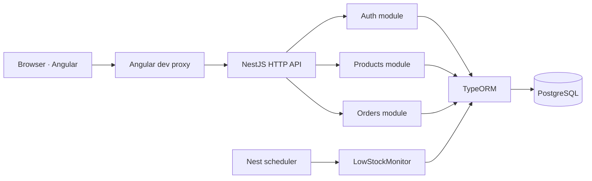
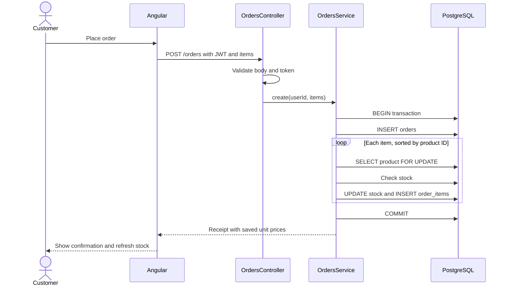

# Architecture

## System view

The development proxy in `frontend/proxy.conf.json` forwards `/auth/**`,
`/products/**`, and `/orders/**` to the API on port 3000. The browser
therefore talks to port 4200 during local development. This proxy is a
development-server feature; a deployed frontend needs equivalent routing or
an explicit API origin with CORS configured on the backend.

## Source ownership

| Path                            | Responsibility                                                                   |
| ------------------------------- | -------------------------------------------------------------------------------- |
| `backend/src/main.ts`           | Bootstraps Nest and installs the global validation pipe.                         |
| `backend/src/app.module.ts`     | Loads environment variables, PostgreSQL/TypeORM, scheduling and feature modules. |
| `backend/src/auth/`             | User entity, registration/login, JWT creation and guards.                        |
| `backend/src/products/`         | Product entity, admin CRUD, browsing and low-stock monitor.                      |
| `backend/src/orders/`           | Order and order-item entities, request DTO, checkout transaction.                |
| `frontend/src/app/store-api.ts` | Typed calls to the backend.                                                      |
| `frontend/src/app/app.ts`       | Session, product, bag, checkout and admin UI state.                              |
| `frontend/src/app/app.html`     | One responsive screen with sign-in, shop, bag and admin views.                   |
| `frontend/src/styles.css`       | Global visual design and responsive breakpoints.                                 |

The Angular app uses standalone components and signals. `app.routes.ts` is
currently empty: the views are switched inside the root component, not by URL.
The bag exists only in browser memory and clears on reload. Login information
is kept in the tab's `sessionStorage` until sign-out, tab close, or a 401
response.

## Authentication and authorization

1. Registration checks email and password, normalizes email to lowercase,
   hashes the password with bcrypt (12 rounds), and creates a `customer`.
2. Login compares the supplied password with the stored hash and returns a
   signed JWT plus public user fields. The password hash is excluded from
   ordinary TypeORM selects and never returned by the API.
3. `JwtAuthGuard` checks the `Authorization: Bearer <token>` header and
   attaches the token's user ID and role to the request.
4. `AdminGuard` additionally requires `role === 'admin'` on product writes.

The JWT expires after 3,600 seconds (one hour). Its role is a snapshot from
login time: after changing a user's role in the database, that user must log
in again. Hiding admin controls in Angular is only presentation; NestJS is
the permission boundary.

## Checkout flow

If a product is missing or stock is insufficient, the service throws an
exception. TypeORM rolls back the order, its items and earlier stock changes
from that transaction. `pessimistic_write` locks product rows until the
transaction ends, so simultaneous checkouts do not both consume the same
stock. Sorting product IDs gives transactions a consistent lock order.

The frontend sends only product IDs and quantities. It does not decide the
customer ID, final price or stock: the API gets the customer ID from the JWT
and reads each product's current price and stock inside the transaction.
`unit_price_cents` records the price paid even if the product price changes.

## Scheduled work

`LowStockMonitor` uses `@Interval(60_000)` to query products with stock
of 4 or less once a minute and writes a Nest warning. It is active only while
the API process is running. It does not send emails, change stock or persist
notifications.

## Configuration and deployment boundaries

The API reads `DB_HOST`, `DB_PORT`, `DB_USERNAME`, `DB_PASSWORD`,
`DB_NAME`, `JWT_SECRET` and optional `PORT` from its environment.
`backend/.env` is for local use and is ignored by Git. The frontend has
no secret configuration; it calls relative API paths.

`synchronize: true` in `AppModule` is convenient for a disposable local
database, but is not a migration system. Before production deployment,
introduce migrations, turn synchronization off, provide managed PostgreSQL,
configure HTTPS and routing between the frontend and API, and supply real
secrets through the deployment platform.
