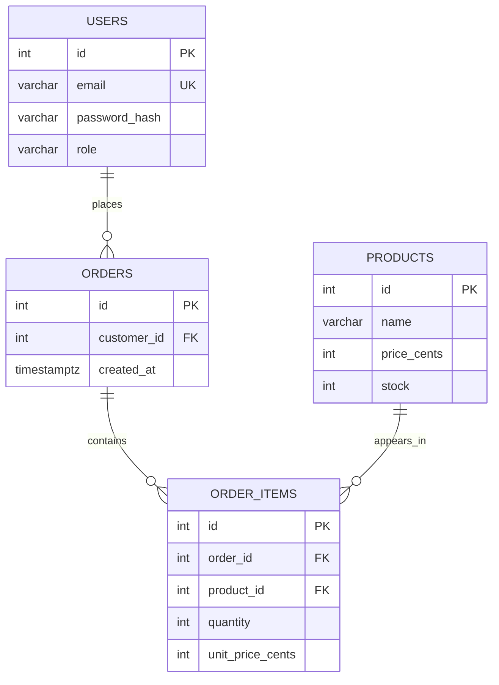

# Database

The database is PostgreSQL. TypeORM entity definitions in `backend/src`
currently generate the schema at API startup because `synchronize: true`
is enabled for local development. No migration files are present.

## Entity relationship diagram



One user can place many orders. One order can have many order items. One
product can appear in many order items. This makes the orders-to-products
relationship many-to-many through `order_items`; the linking row also
stores quantity and the price paid. The database allows an order with zero
items, but the `POST /orders` DTO requires at least one.

## Table reference

### `users`

| Column          | Type              | Rule                                   | Meaning                                       |
| --------------- | ----------------- | -------------------------------------- | --------------------------------------------- |
| `id`            | generated integer | Primary key                            | User identity.                                |
| `email`         | `varchar(255)`    | Unique, required                       | Login identifier; lowercased by registration. |
| `password_hash` | `varchar(255)`    | Required, excluded from normal selects | bcrypt hash; never plaintext.                 |
| `role`          | `varchar(20)`     | Default `customer`                     | App uses `customer` or `admin`.               |

The database does not currently have a `CHECK` constraint restricting
`role` to the two application values.

### `products`

| Column        | Type              | Rule                    | Meaning                 |
| ------------- | ----------------- | ----------------------- | ----------------------- |
| `id`          | generated integer | Primary key             | Product identity.       |
| `name`        | `varchar(120)`    | Required                | Display name.           |
| `price_cents` | integer           | `CHECK >= 0`            | Current price in cents. |
| `stock`       | integer           | Default 0, `CHECK >= 0` | Available units.        |

The frontend displays `price_cents / 100` as USD and converts admin dollar
input back to integer cents before calling the API.

### `orders`

| Column        | Type              | Rule                     | Meaning                        |
| ------------- | ----------------- | ------------------------ | ------------------------------ |
| `id`          | generated integer | Primary key              | Order identity.                |
| `customer_id` | integer           | Required FK → `users.id` | Customer who placed the order. |
| `created_at`  | `timestamptz`     | Generated at creation    | Order creation time.           |

`idx_orders_customer_id` is a B-tree index on `customer_id`. It supports
finding a customer's orders, though there is no order-history API yet.
PostgreSQL may scan the table instead for a tiny dataset; an index is useful
as data grows and also adds write/storage cost.

### `order_items`

| Column             | Type              | Rule                        | Meaning                     |
| ------------------ | ----------------- | --------------------------- | --------------------------- |
| `id`               | generated integer | Primary key                 | Receipt-line identity.      |
| `order_id`         | integer           | Required FK → `orders.id`   | Parent order.               |
| `product_id`       | integer           | Required FK → `products.id` | Purchased product.          |
| `quantity`         | integer           | `CHECK > 0`                 | Units bought.               |
| `unit_price_cents` | integer           | `CHECK >= 0`                | Price per unit at checkout. |

The current schema has no uniqueness constraint on
`(order_id, product_id)`; a request can produce more than one line for the
same product. The service processes repeated lines separately.

## Why keep a price on the order item?

`products.price_cents` is the price **now**. If an admin changes a book from
$15.00 to $18.00 tomorrow, yesterday's order must still show the $15.00
purchase price. `order_items.unit_price_cents` is that snapshot.

## Inspecting local data

DBeaver can connect using host `localhost`, port `5432`, database
`store_db`, user `postgres`, and the password from your local
`backend/.env`. Tables live under `Schemas → public → Tables`.

To view saved orders with their items, run this read-only query in DBeaver:

```sql
SELECT
    o.id AS order_id,
    u.email AS customer_email,
    p.name AS product_name,
    oi.quantity,
    oi.unit_price_cents,
    oi.quantity::bigint * oi.unit_price_cents AS line_total_cents
FROM public.orders AS o
JOIN public.users AS u ON u.id = o.customer_id
JOIN public.order_items AS oi ON oi.order_id = o.id
JOIN public.products AS p ON p.id = oi.product_id
ORDER BY o.id, oi.id;
```

The `JOIN` clauses follow the foreign keys to assemble one readable
receipt. To find one customer's orders, filter `orders.customer_id`:

```sql
SELECT id, customer_id, created_at
FROM public.orders
WHERE customer_id = 1
ORDER BY created_at DESC;
```

## Schema changes

Because this project has no migrations yet, avoid using the current
`synchronize: true` setup on valuable or production data. For future
schema changes, introduce versioned TypeORM migrations, review the generated
SQL, and test both upgrade and rollback paths before switching
`synchronize` off in production.
